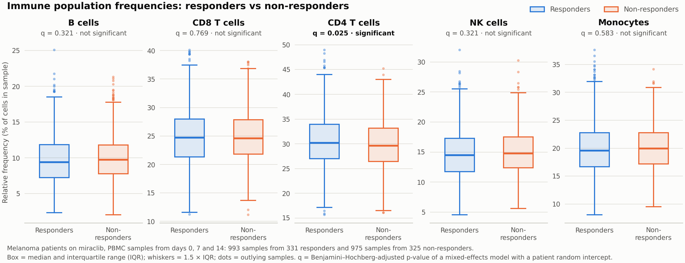
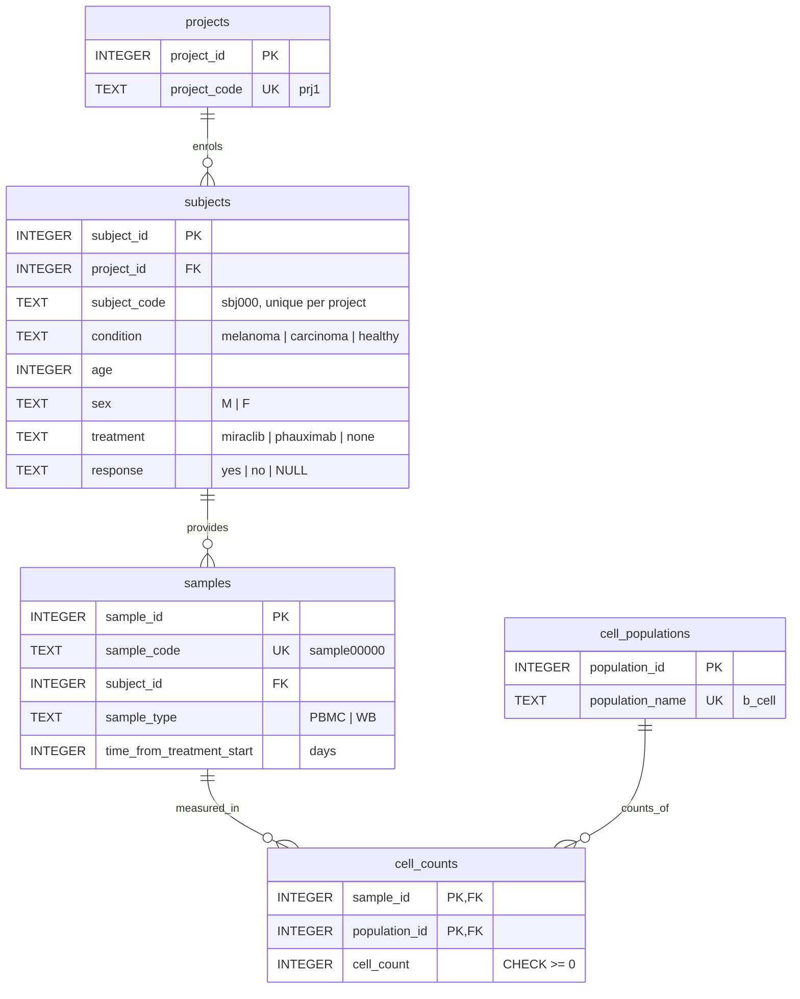

# Loblaw Bio – miraclib immune profiling

Analysis of immune cell populations in Loblaw Bio's miraclib clinical trial. The pipeline loads
`cell-count.csv` into a normalised SQLite database (Part 1), computes the relative frequency of five
immune populations in every sample (Part 2), tests whether those frequencies differ between
responders and non-responders to miraclib (Part 3), and summarises a baseline subset of the trial
(Part 4). An interactive Streamlit dashboard presents Parts 2–4 straight from the database.

## Quick start (GitHub Codespaces)

Open the repository in a codespace (**Code → Codespaces → Create codespace**). The dev container uses
Python 3.12 and runs `make setup` for you, but each step can also be run by hand from the repository root:

```bash
make setup
```

```bash
make pipeline
```

```bash
make dashboard
```

| Target | What it does |
|---|---|
| `make setup` | Creates `.venv/` and installs the pinned dependencies from `requirements.txt`. |
| `make pipeline` | Runs `python load_data.py` (Part 1: builds `cell_counts.db`), then `python run_analysis.py` (Parts 2–4: writes `outputs/`). |
| `make dashboard` | Serves the dashboard at http://localhost:8501 (builds the database first if it is missing). |
| `make test` | Runs the test suite (40 tests). |

Any target that needs Python runs `make setup` first if `.venv/` does not exist yet. The only
prerequisites are Python 3.11+ and `make`. `load_data.py` itself uses only the standard library, so
`python load_data.py` works even before `make setup`.

## Dashboard

**Link: <http://localhost:8501>** (start it with `make dashboard`).

In Codespaces, port 8501 is forwarded automatically: use the **Open in Browser** prompt, or the
**Ports** tab → port 8501 → globe icon. The forwarded URL looks like
`https://<codespace-name>-8501.app.github.dev`.

The dashboard reads `cell_counts.db` and uses the same analysis functions as the pipeline, so its
numbers always match `outputs/`. It has three tabs:

- **Part 2 · Cell frequencies**: the full summary table (searchable, filterable by population,
  downloadable). Selecting a row shows that sample against the distribution of all samples.
- **Part 3 · Responders vs non-responders**: plain-language findings, boxplots per population
  (all timepoints or one day at a time), the statistics table, and mean trajectories over days 0/7/14.
- **Part 4 · Baseline subset**: the average B-cell count of male melanoma responders at baseline, then
  the answers to Bob's subset questions. The subset filters default to his question but can be changed
  to explore any condition, treatment, sample type and timepoint. The SQL behind each number is shown.

## Results

All numbers below are produced by `make pipeline`; the full write-up is in
[`outputs/report.md`](outputs/report.md).

### Part 2: relative frequencies

[`outputs/part2_cell_frequencies.csv`](outputs/part2_cell_frequencies.csv) has one row per sample and
population (10,500 samples × 5 populations = 52,500 rows) with the columns `sample`, `total_count`,
`population`, `count` and `percentage`. Across all samples the average composition is CD4 T cells
30.3%, CD8 T cells 24.9%, monocytes 20.0%, NK cells 14.9% and B cells 9.9%.

### Part 3: responders vs non-responders (melanoma, miraclib, PBMC)

The cohort is 331 responders (993 samples) and 325 non-responders (975 samples), each sampled on days 0, 7 and 14.



**CD4 T cells (`cd4_t_cell`) show a statistically significant association with response under the
primary mixed-effects model** (Benjamini–Hochberg q = 0.025). Responders have 0.64 percentage points
more CD4 T cells (95% CI 0.19 to 1.08; p = 0.005). The effect is small and has limited predictive value.
The secondary, distribution-free Mann–Whitney U test points the same way (unadjusted p = 0.013) but is
**not significant after its multiple-testing correction (q = 0.067)**, so the evidence is moderate
rather than conclusive. No other population is significant under either test.

| population | median % (R) | median % (NR) | difference, pp (95% CI) | mixed-model p | mixed-model q | Mann–Whitney p | Mann–Whitney q | AUC |
|---|---:|---:|---:|---:|---:|---:|---:|---:|
| b_cell | 9.43 | 9.79 | −0.20 (−0.48 to +0.09) | 0.171 | 0.321 | 0.056 | 0.139 | 0.475 |
| cd8_t_cell | 24.73 | 24.60 | −0.06 (−0.48 to +0.35) | 0.769 | 0.769 | 0.639 | 0.639 | 0.494 |
| **cd4_t_cell** | 30.22 | 29.66 | +0.64 (+0.19 to +1.08) | **0.005** | **0.025** | 0.013 | 0.067 | 0.532 |
| nk_cell | 14.51 | 14.80 | −0.23 (−0.58 to +0.12) | 0.193 | 0.321 | 0.121 | 0.202 | 0.480 |
| monocyte | 19.61 | 19.94 | −0.14 (−0.53 to +0.24) | 0.466 | 0.583 | 0.163 | 0.204 | 0.482 |

What this means for predicting response:

- **Small effect, limited predictive value.** AUC = 0.53 (0.5 = chance), so CD4 frequency on its own
  barely separates responders from non-responders.
- **Not present before treatment.** At baseline (day 0) no population differs (CD4 p = 0.80; all
  populations p ≥ 0.21), so there is no evidence that baseline frequencies of these populations predict
  response. The CD4 gap appears only on treatment (unadjusted day 7 p = 0.030, day 14 p = 0.075), and
  neither per-timepoint test survives correction. CD4 frequency is therefore at most a candidate early
  *on-treatment* marker of response, not a pre-treatment predictor.
- An isolated lower B-cell frequency in responders on day 14 (unadjusted p = 0.014) does not survive FDR
  correction across the 15 per-timepoint tests (q = 0.22). It is a hypothesis to follow up, not a finding.

### Part 4: baseline subsets

**Melanoma PBMC samples at baseline from miraclib-treated patients:** 656 samples from 656 subjects
(one baseline sample per subject).

| Samples per project | | Subjects by response | | Subjects by sex | |
|---|---:|---|---:|---|---:|
| prj1 | 384 | responders | 331 | male | 344 |
| prj2 | 0 | non-responders | 325 | female | 312 |
| prj3 | 272 | | | | |

prj2 contributes no samples because it collected only whole blood (WB), not PBMC.

**Average B cells in male melanoma responders at baseline.** Considering melanoma males of all sample and
treatment types, the average number of B cells for responders at time = 0 is **10206.15**. That is the
mean of 485 samples from 485 subjects, covering both treatments (miraclib and phauximab) and both sample
types (PBMC and WB). The query is `MEAN_COUNT_SQL` in [`analysis/subsets.py`](analysis/subsets.py), and the
result is in
[`outputs/part4_avg_b_cells_melanoma_male_responders.csv`](outputs/part4_avg_b_cells_melanoma_male_responders.csv).

## How the statistics work (Part 3)

- **Primary test: linear mixed-effects model.** Each patient contributes three samples (days 0, 7, 14),
  so samples are not independent observations. For each population we fit
  `percentage ~ responder + C(timepoint) + (1 | patient)`. The `responder` coefficient is the difference
  in mean relative frequency (percentage points) between the groups, adjusted for timepoint, and the
  patient random intercept accounts for repeated sampling.
- **Multiple testing.** Five populations are tested, so p-values are adjusted with the Benjamini–Hochberg
  false discovery rate. A population is called significant when q < 0.05.
- **Secondary check: Mann–Whitney U.** A two-sided rank test on the sample-level frequencies (the data in
  the boxplots) that makes no normality assumption, FDR-adjusted the same way. Its AUC (the probability
  that a random responder sample has a higher frequency than a random non-responder sample) measures how
  useful a population would be for predicting response.
- **Reading the two together.** The tests measure different things: the mixed model tests a difference in
  mean frequency, while the rank test asks whether one group's values tend to rank higher. They need not
  agree. For CD4 T cells only the primary test survives correction, which is why the evidence is
  described as moderate rather than conclusive.
- **Timing.** The same rank test at each timepoint shows whether a difference exists before treatment or
  only appears on treatment. These tests are exploratory and FDR-adjusted across all 15 of them.
- **A note on the fit.** The estimated between-patient variance is ≈ 0 for every population: a patient's
  samples are no more alike than samples from different patients. Accounting for repeated sampling
  therefore barely changes the estimates. statsmodels' boundary warnings are expected here and are handled. The model is
  fitted with derivative-free optimisers first, because gradient-based ones can hit a singular matrix at
  that boundary.

## Database schema (Part 1)



The full DDL is in [`load_data.py`](load_data.py). Two views cover the common read patterns:
`cell_frequencies` (the Part 2 table, computed in SQL with window functions) and `sample_metadata`
(one row per sample with its subject and project attributes).

**Why this design**

- **Each fact is stored once (third normal form).** Indication, age, sex, treatment and response
  describe the *patient*, so they live in `subjects` rather than being repeated on all three of a
  patient's samples. `load_data.py` verifies that these attributes really are constant per subject and
  refuses to load the CSV otherwise. Sample type and timepoint describe the *sample*.
- **Cell counts are long, not wide.** `cell_counts` has one row per (sample, population). A new
  population, or a whole new cytometry panel, is new rows in `cell_populations` and `cell_counts`, not
  a schema change. Every query works over all populations without naming columns.
- **Integrity is enforced by the database.** Foreign keys link every row to its parent. `CHECK`
  constraints reject negative counts and unknown response or sex values. `UNIQUE` constraints prevent
  duplicate samples. Integer surrogate keys keep joins compact. Subject codes only need to be unique
  within a project, because studies often reuse IDs such as `001`.
- **Indexes match the analyses.** They cover cohort filters (condition, treatment, response), sample
  filters (sample type, timepoint) and every foreign key. The Part 4 query plan uses
  `idx_samples_type_timepoint`.
- **Safe rebuilds.** The database is built into a temporary file and swapped into place only after the
  load and integrity checks pass. A bad CSV never leaves a half-built database, and the dashboard never
  reads one.

**Scaling to hundreds of projects, thousands of samples and more analytics**

- The row counts that grow are `samples` and `cell_counts`. Both are narrow, integer-keyed tables, so
  SQLite comfortably handles millions of rows on one machine. For many concurrent users, the same schema
  moves unchanged to PostgreSQL, where `cell_counts` can be partitioned by project.
- New analyses query the views instead of re-implementing the frequency arithmetic. Expensive results
  (e.g. frequencies over millions of samples) can be materialised as tables refreshed by the pipeline.
- Natural extensions would be:
  - lookup tables for controlled vocabularies (conditions, treatments, sample types);
  - a `panels` or `assays` table when several cytometry panels coexist;
  - a treatment-exposure table (subject, treatment, start date) once patients can switch therapies,
    because treatment then stops being a fixed subject attribute;
  - an `analysis_runs` table recording which data and code version produced each result.

## Code structure

```
├── load_data.py          Part 1: schema + loader (standard library only)
├── run_analysis.py       Parts 2–4: runs the analyses and writes outputs/
├── dashboard.py          Streamlit dashboard for Parts 2–4
├── analysis/             shared analysis package (used by the pipeline and the dashboard)
│   ├── db.py             read-only database connections
│   ├── frequencies.py    Part 2: relative-frequency table
│   ├── responders.py     Part 3: cohort selection, mixed model, Mann–Whitney, findings
│   ├── subsets.py        Part 4: parameterised SQL for the baseline subset and the B-cell question
│   ├── plots.py          static boxplot figure (matplotlib)
│   ├── report.py         outputs/report.md
│   └── theme.py          labels and colour-blind-safe palette
├── tests/                pytest suite: loader, SQL results vs pandas, statistics, pipeline, dashboard
├── outputs/              generated results (committed for reference; rebuilt by make pipeline)
├── cell-count.csv        input data
├── Makefile · requirements.txt · pytest.ini
├── .devcontainer/        Codespaces configuration (Python 3.12, port 8501)
└── .streamlit/           dashboard server and theme configuration
```

- **One source of truth.** The pipeline and the dashboard call the same `analysis` functions on the same
  database, so the CSVs, the report and the dashboard cannot disagree. Part 2 is a SQL view, and Part 4
  is a set of parameterised SQL queries over one shared filter. The database answers those questions
  directly, and the dashboard shows the SQL.
- **Functions take a connection and return DataFrames.** That keeps them easy to test against a
  temporary database (the tests never touch the repository's `cell_counts.db`) and easy to reuse.
- **Conclusions are generated from the numbers.** The findings text in the report and dashboard is built
  from the statistics, so it cannot drift from them. Tests pin the headline results.
- **Reproducible.** Dependencies are pinned, the dev container pins Python, and the outputs are
  deterministic: re-running `make pipeline` reproduces the committed files byte for byte.

## Testing

```bash
make test
```

The 40 tests check, among other things, that:

- the database round-trips every value of the CSV;
- the loader rejects inconsistent input and keeps the previous database when a build fails;
- the SQL results for Parts 2 and 4 match an independent pandas computation;
- the statistics detect a planted difference in simulated data and reproduce the reported findings;
- every output is written;
- the dashboard renders without errors (via Streamlit's `AppTest`), including when it has to build
  its own database, as on a hosted deployment.

## Notes and assumptions

- The task's *indication* and *gender* are the CSV's `condition` and `sex` columns; the database keeps
  the CSV names.
- `time_from_treatment_start` is in days; 0 is baseline.
- `response` is blank for the 474 healthy, untreated subjects and is stored as `NULL`.
- Running locally without Codespaces works the same way on macOS or Linux with Python 3.11+.
  `make setup` uses `python3` (override with `make setup PYTHON=python3.12`), and to run scripts directly,
  activate the environment first with `source .venv/bin/activate`.
- To host the dashboard, deploy this repository's `main` branch on [Streamlit Community Cloud](https://streamlit.io/cloud)
  with `dashboard.py` as the entry point and Python 3.12. The database is not committed, so a hosted app builds
  it from `cell-count.csv` on first start (in the temp folder if the code folder is read-only). A hosted app
  that has not been opened for a while goes to sleep; waking it takes about a minute.
