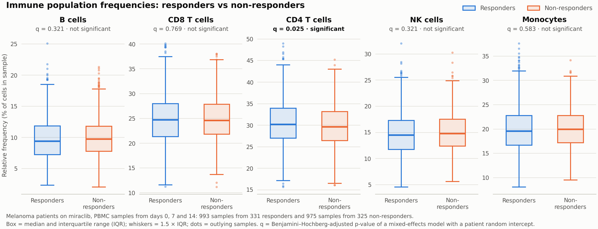

# Miraclib immune-profiling results

_Generated by `make pipeline` (`run_analysis.py`) from `cell_counts.db`. Do not edit by hand._

## Part 2 – Relative frequency of each population per sample

`part2_cell_frequencies.csv` has one row per sample and population (10,500 samples × 5 populations = 52,500 rows) with columns `sample, total_count, population, count, percentage`, where `total_count` is the sum of the five populations in the sample and `percentage` = 100 × `count` / `total_count`.

Distribution of each population's relative frequency across all samples:

| population | mean % | median % | IQR % | range % |
|---|---:|---:|---:|---:|
| b_cell | 9.88 | 9.61 | 7.64–11.77 | 1.69–25.12 |
| cd8_t_cell | 24.91 | 24.70 | 21.77–27.76 | 11.17–45.29 |
| cd4_t_cell | 30.27 | 30.18 | 26.97–33.38 | 14.26–49.03 |
| nk_cell | 14.92 | 14.69 | 12.33–17.26 | 3.98–32.05 |
| monocyte | 20.02 | 19.83 | 17.13–22.69 | 5.80–37.94 |

## Part 3 – Responders vs non-responders

Cohort: melanoma patients treated with miraclib, PBMC samples. 331 responders (993 samples) and 325 non-responders (975 samples); every patient was sampled on days 0, 7 and 14.

### Findings

- **cd4_t_cell** shows a statistically significant association with response under the primary mixed-effects model: its relative frequency is 0.64 percentage points higher in responders (95% CI 0.19 to 1.08; p = 0.005, FDR q = 0.025).
- The secondary, distribution-free Mann–Whitney U test points the same way (unadjusted p = 0.013) but is not significant after FDR correction (q = 0.067), so the evidence is moderate rather than conclusive.
- The effect is small, with limited predictive value: AUC = 0.53 (0.5 = no separation, 1 = perfect), so cd4_t_cell frequency alone barely separates responders from non-responders.
- There is no cd4_t_cell difference at baseline (day 0 p = 0.796); it appears only on treatment (unadjusted day 7 p = 0.030, day 14 p = 0.075; none of these survives FDR correction), so cd4_t_cell is at most a candidate early on-treatment marker of response, not a pre-treatment predictor.
- None of the other populations is significant: b_cell, cd8_t_cell, nk_cell, monocyte have mixed-model q ≥ 0.321 (smallest Mann–Whitney p = 0.056).
- Isolated single-timepoint differences (b_cell on day 14, p = 0.014) do not survive FDR correction across the 15 timepoint tests (q ≥ 0.216); treat them as hypotheses to follow up, not findings.
- At baseline (day 0) no population differs between the groups (all Mann–Whitney p ≥ 0.211), so there is no evidence that pre-treatment frequencies of these 5 populations predict response.

### Statistics per population

| population | median % (R) | median % (NR) | difference, pp (95% CI) | mixed-model p | q (FDR) | Mann–Whitney p | MWU q | AUC | significant (mixed model) |
|---|---:|---:|---:|---:|---:|---:|---:|---:|---|
| b_cell | 9.43 | 9.79 | −0.20 (−0.48 to +0.09) | 0.171 | 0.321 | 0.056 | 0.139 | 0.475 | no |
| cd8_t_cell | 24.73 | 24.60 | −0.06 (−0.48 to +0.35) | 0.769 | 0.769 | 0.639 | 0.639 | 0.494 | no |
| cd4_t_cell | 30.22 | 29.66 | +0.64 (+0.19 to +1.08) | 0.005 | 0.025 | 0.013 | 0.067 | 0.532 | **yes** |
| nk_cell | 14.51 | 14.80 | −0.23 (−0.58 to +0.12) | 0.193 | 0.321 | 0.121 | 0.202 | 0.480 | no |
| monocyte | 19.61 | 19.94 | −0.14 (−0.53 to +0.24) | 0.466 | 0.583 | 0.163 | 0.204 | 0.482 | no |

R = responders, NR = non-responders, pp = percentage points (responders − non-responders).

Method: for each population, a linear mixed-effects model `percentage ~ responder + C(timepoint) + (1 | patient)` estimates the difference in mean relative frequency between responders and non-responders while accounting for the three samples per patient; p-values are adjusted across the five populations with the Benjamini–Hochberg false discovery rate, and a population is called significant at q < 0.05. A two-sided Mann–Whitney U test on the sample-level frequencies (the data in the boxplots) is a secondary, distribution-free check, adjusted the same way; AUC is the probability that a random responder sample has the higher frequency (0.5 = no separation). The two tests measure different things (a difference in mean frequency vs. a tendency for one group's values to rank higher), so they need not agree; where only the primary test survives correction, the evidence should be read as moderate, not conclusive.

### By timepoint (exploratory)

Two-sided Mann–Whitney U p-values (unadjusted) comparing responders and non-responders at each timepoint. A predictor of response would have to differ at baseline (day 0).

| population | day 0 p | day 7 p | day 14 p |
|---|---:|---:|---:|
| b_cell | 0.549 | 0.144 | 0.014 |
| cd8_t_cell | 0.514 | 0.638 | 0.741 |
| cd4_t_cell | 0.796 | 0.030 | 0.075 |
| nk_cell | 0.885 | 0.138 | 0.315 |
| monocyte | 0.211 | 0.484 | 0.647 |

## Part 4 – Baseline subset

Filter: melanoma · miraclib · PBMC · day 0 (`condition = 'melanoma'`, `treatment = 'miraclib'`, `sample_type = 'PBMC'`, `time_from_treatment_start = 0`): **656 samples** from **656 subjects**. The sample list is in `part4_baseline_samples.csv`.

Samples per project:

| project | samples |
|---|---:|
| prj1 | 384 |
| prj2 | 0 |
| prj3 | 272 |

Subjects by response:

| response | subjects |
|---|---:|
| Responders (yes) | 331 |
| Non-responders (no) | 325 |

Subjects by sex:

| sex | subjects |
|---|---:|
| Male (M) | 344 |
| Female (F) | 312 |

### Average B cells: male melanoma responders at baseline

Considering melanoma males of all sample and treatment types, the average number of B cells for responders at time = 0 is **10206.15** (485 samples from 485 subjects; filter: melanoma · male · responders · day 0 · all treatments and sample types). Result in `part4_avg_b_cells_melanoma_male_responders.csv`.
